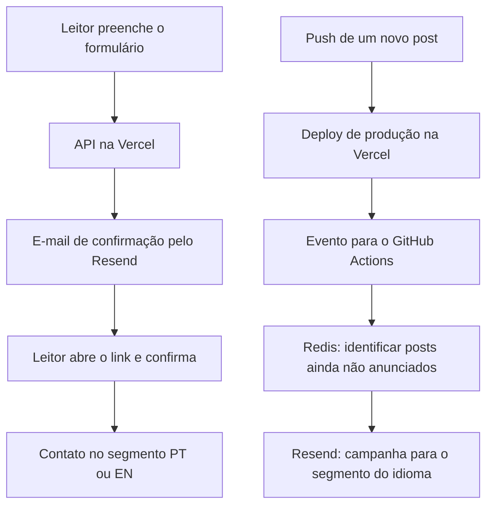

The idea seemed simple: I published a blog post, and anyone subscribed to the newsletter received an email. In practice, I needed to connect subscription confirmation, deploy, automation, and retry control.

In this post, I detail how I set up the CommandLinux newsletter and the problems that arose until the notice reached the inbox. The examples use generic names; personal information and confirmation links in the screenshots have been censored.

## Two different paths

One of the first things I needed to separate was reader registration from the new article notification.



Confirmation works on APIs hosted on Vercel. Article notifications run on GitHub Actions after the production deploy. Receiving the first email, therefore, does not prove that the second path is configured.

## Confirm before registering

The form sends email and language to the API. It creates a random token, stores its hash in Redis with a 24-hour validity, and sends the confirmation link.

Opening the link shows a page with a button. Only the POST of this button attempts to register the contact. This choice prevents a simple visit to the link by an email scanner from confirming the subscription.

The confirmed contact enters either the Portuguese or English segment. The code preserves global unsubscribes and unsubscribes imported from the previous solution.


*Confirmation with the blog's brand identity. The individual link is not necessary to understand the flow and has been hidden.*

## Error 401: I could send, but not register

The first email arrived. Upon confirmation, however, the API returned 503. The Resend log revealed the cause: the contact query returned 401 with `restricted_api_key`.

The key had **Sending access**. It allowed sending the email but not querying and managing contacts. Our implementation also depends on segments and Broadcasts, so it needed a key with compatible access.

I used a blog-specific key with **Full access**. This requires understanding the scope of the permission: it can manage team resources, not just those of the domain used by the sender. Separating segments in the code does not create a permission barrier between projects of the same team. The [Resend API Keys documentation](https://resend.com/docs/api-reference/api-keys/create-api-key) describes this difference.

## Job skipped: the sending hadn't even started

After confirmation worked, the article notification still wasn't arriving. In Actions, the job appeared as `skipped`.


*The skipped job did not call the sending API.*

The filter required the Project ID of the Vercel project. I had registered this information as a Secret, while the YAML was looking for a Variable:

```yaml
vars.NEWSLETTER_VERCEL_PROJECT_ID
```

In Actions, `vars` and `secrets` are different contexts. Saving the same name in Secrets does not populate a read made by `vars`. This distinction is in the [GitHub contexts reference](https://docs.github.com/en/actions/reference/workflows-and-actions/contexts).

The organization used in the project was as follows:

| Configuration | Where it is on GitHub |
| --- | --- |
| `NEWSLETTER_VERCEL_PROJECT_ID` | Repository variable |
| `RESEND_SEGMENT_PT` and `RESEND_SEGMENT_EN` | Repository variables |
| `NEWSLETTER_ENABLED` and `NEWSLETTER_MIGRATION_COMPLETE` | Repository variables |
| `RESEND_API_KEY` | Repository secret |
| `UPSTASH_REDIS_REST_URL` and `UPSTASH_REDIS_REST_TOKEN` | Repository secrets |

The flags should only enable sending after completing the configuration and reconciling the contact migration.

I also corrected an assumption in the filter: the `alias` field of the Vercel event is optional. Validation still requires project, production, and the `main` branch; if aliases are provided, it also checks the domain. The [official event definitions](https://github.com/vercel/repository-dispatch/blob/main/packages/repository-dispatch/src/data/deployment.ts) show this optional property.

## Redis configured in one service doesn't configure the other

The job started executing but failed due to missing Redis URL and token.

Vercel server configurations are not automatically GitHub runner configurations. Additionally, the names need to match the YAML.

In this project, Vercel's integration provided `REDIS_KV_REST_API_URL` and `REDIS_KV_REST_API_TOKEN`. In Actions, I saved these values as `UPSTASH_REDIS_REST_URL` and `UPSTASH_REDIS_REST_TOKEN`, the names the workflow already expected.

The important thing was to point to the same production database and use the REST write token. Test database and production database should not share sending test state.

## Why didn't the first run send old posts?

In the first valid run, the script registers the published archive as a starting point and saves the production SHA to Redis. This prevents announcing the entire blog history at once.

After this initialization, it compares the new deployment with the previous one. New articles and draft publications can generate notifications; editing an already announced post should not generate another send.

To test this path, I needed to publish another article after initialization.

## Error 422: campaign name was too long

When it finally reached campaign creation, a 422 appeared. The response body pointed to the `name` field and its 70-character limit.

I was reusing the internal Redis key as the campaign name:

```text
newsletter:article:<64-character SHA-256 hash>
```

The prefix combined with the hash exceeded the limit. The correction was to keep the full key in Redis and use only the 64-character hash in the name sent to Resend.

The title remained in the email subject. The [Broadcasts creation documentation](https://resend.com/docs/api-reference/broadcasts/create-broadcast) presents the fields used in this request.

## Duplication protection also appeared in the test

Before calling Resend, the script reserves a key per article and language in Redis. If an ambiguous failure occurs, such as a timeout after a possible acceptance, automatically retrying could send the same notification twice.

Therefore, an unresolved attempt blocks resends until it is checked. This is what appeared as `Reconcile unresolved delivery` after the 422.

In this specific case, the log confirmed a validation rejection. I reconciled the attempt and removed only that article's reservation. Then, I re-executed the workflow with the published correction, and the notification was sent.

**Deleting reservations is not a procedure for every failure.** First, you need to check what happened with the provider. The fix also started releasing the reservation when the API explicitly responds with 422, maintaining the block for ambiguous failures.

## The result

At the end of the test, the subscription was confirmed, the contact entered the correct segment, and the article notification arrived via email.


*After corrections and reconciliation of the rejected attempt, the job completed in 24 seconds. The screenshot shows the successful execution; the arrival of the notification was also checked in the inbox.*

The message uses the post's title and summary, a button to continue reading on the blog, and Resend's native unsubscribe option. The confirmation also gained responsive HTML and a plain-text alternative.

The most useful lesson was to monitor each step: a delivered confirmation email, a completed deploy, and a successful workflow are evidence of different parts of the system. To validate the entire newsletter, I needed to follow the path from the form to the received notification.
