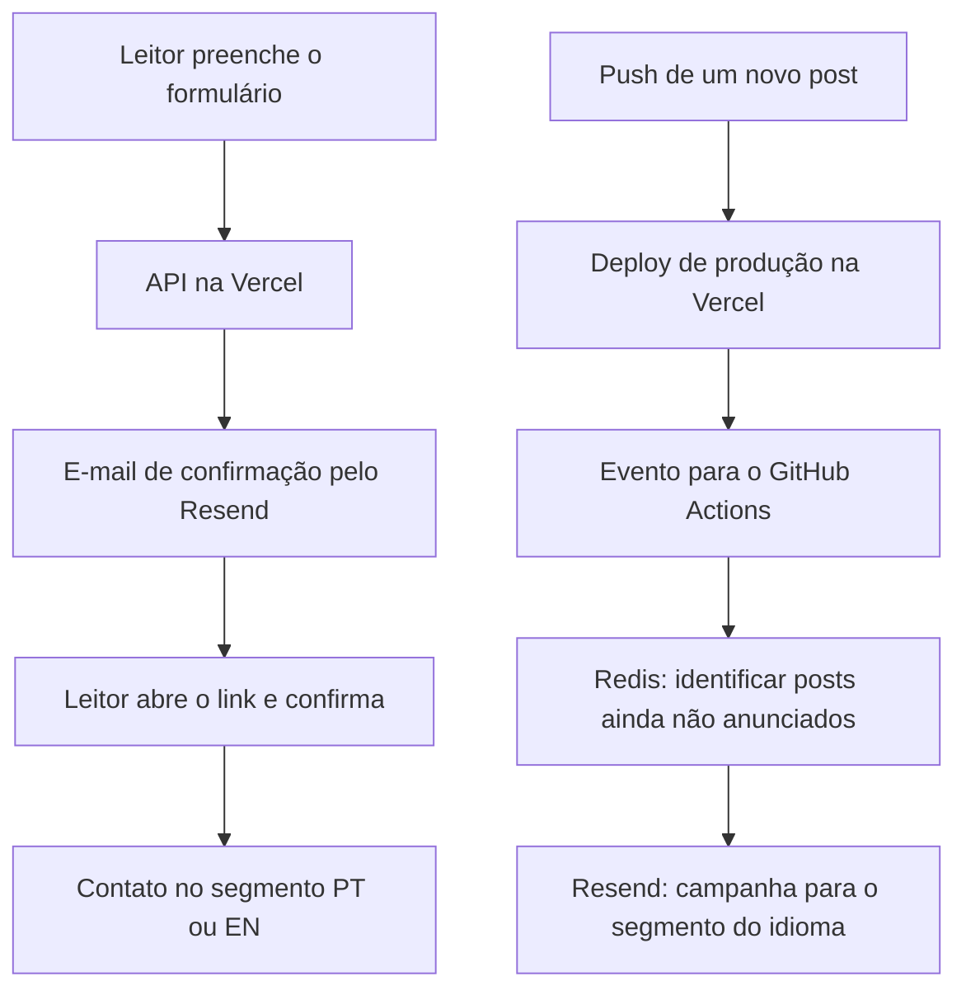
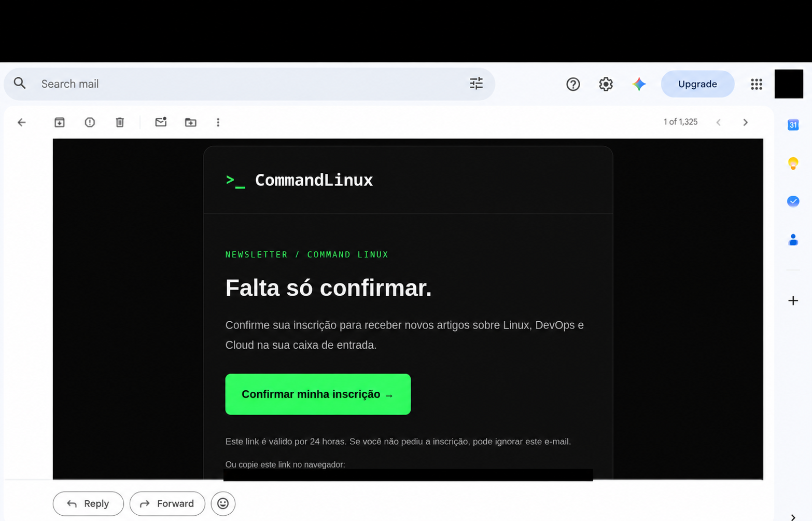
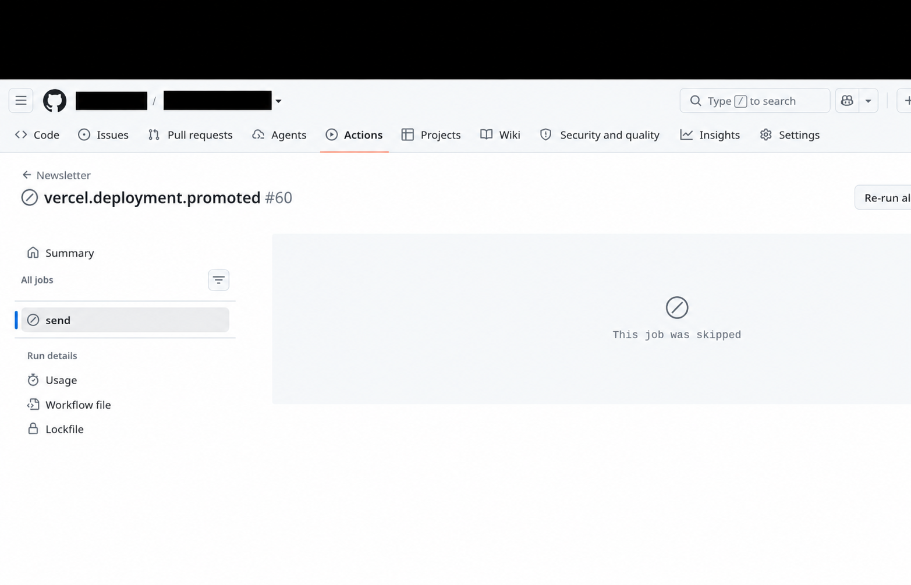
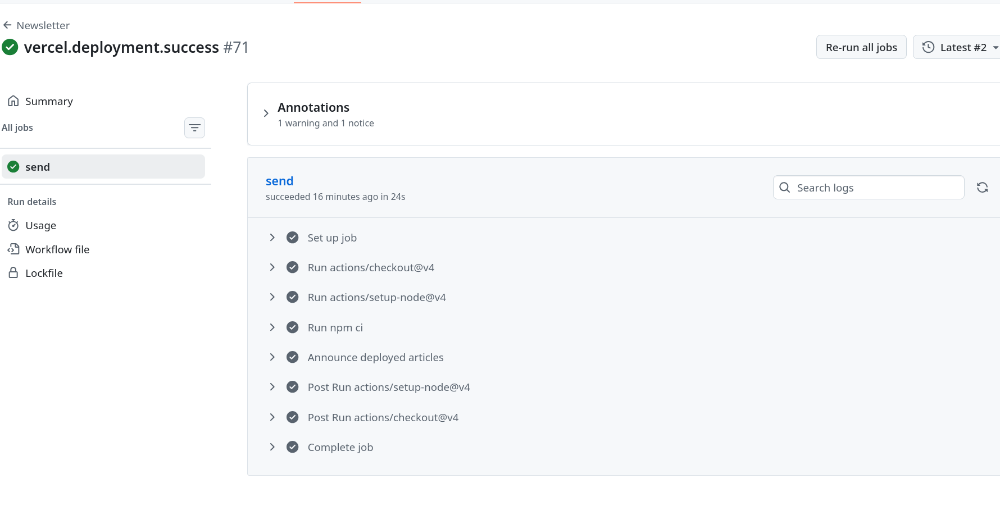

A ideia parecia simples: publiquei um artigo no blog, quem se inscreveu na newsletter recebe um e-mail. Na prática, precisei conectar confirmação de inscrição, deploy, automação e controle de tentativas.

Neste post, registro como montei a newsletter do CommandLinux e os problemas que apareceram até o aviso chegar à caixa de entrada. Os exemplos usam nomes genéricos; os prints tiveram informações pessoais e links de confirmação censurados.

## Dois caminhos diferentes

Uma das primeiras coisas que precisei separar foi o cadastro do leitor do aviso de um novo artigo.



A confirmação funciona nas APIs hospedadas na Vercel. O aviso dos artigos roda no GitHub Actions, depois do deploy de produção. Receber o primeiro e-mail, portanto, não prova que o segundo caminho está configurado.

## Confirmar antes de cadastrar

O formulário envia e-mail e idioma para a API. Ela cria um token aleatório, armazena seu hash no Redis com validade de 24 horas e envia o link de confirmação.

Abrir o link mostra uma página com um botão. Somente o POST desse botão tenta cadastrar o contato. Essa escolha evita que uma simples visita ao link por um scanner de e-mail confirme a inscrição.

O contato confirmado entra no segmento português ou inglês. O código preserva cancelamentos globais e os cancelamentos importados da solução anterior.



*Confirmação com identidade visual do blog. O link individual não é necessário para entender o fluxo e foi ocultado.*

## Erro 401: conseguia enviar, mas não cadastrar

O primeiro e-mail chegou. Ao confirmar, porém, a API devolveu 503. O log do Resend revelou a causa: a consulta ao contato retornava 401 com `restricted_api_key`.

A chave tinha **Sending access**. Ela permitia enviar o e-mail, mas não consultar e gerenciar contatos. Nossa implementação também depende de segmentos e Broadcasts, então precisou de uma chave com acesso compatível.

Usei uma chave própria do blog com **Full access**. Isso exige entender o alcance da permissão: ela pode gerenciar recursos da equipe, não apenas os do domínio usado pelo remetente. Separar segmentos no código não cria uma barreira de permissão entre projetos da mesma equipe. A [documentação das chaves do Resend](https://resend.com/docs/api-reference/api-keys/create-api-key) descreve essa diferença.

## Job skipped: o envio nem tinha começado

Depois da confirmação funcionar, o aviso do artigo ainda não chegava. No Actions, o job aparecia como `skipped`.



*O job pulado não chegou a chamar a API de envio.*

O filtro exigia o Project ID do projeto na Vercel. Eu havia cadastrado essa informação como Secret, enquanto o YAML procurava uma Variable:

```yaml
vars.NEWSLETTER_VERCEL_PROJECT_ID
```

No Actions, `vars` e `secrets` são contextos diferentes. Salvar o mesmo nome em Secrets não preenche uma leitura feita por `vars`. Essa distinção está na [referência de contextos do GitHub](https://docs.github.com/en/actions/reference/workflows-and-actions/contexts).

A organização usada no projeto ficou assim:

| Configuração | Onde fica no GitHub |
| --- | --- |
| `NEWSLETTER_VERCEL_PROJECT_ID` | Repository variable |
| `RESEND_SEGMENT_PT` e `RESEND_SEGMENT_EN` | Repository variables |
| `NEWSLETTER_ENABLED` e `NEWSLETTER_MIGRATION_COMPLETE` | Repository variables |
| `RESEND_API_KEY` | Repository secret |
| `UPSTASH_REDIS_REST_URL` e `UPSTASH_REDIS_REST_TOKEN` | Repository secrets |

Os flags só devem habilitar os envios depois de concluir a configuração e reconciliar a migração dos contatos.

Também corrigi uma suposição no filtro: o campo `alias` do evento da Vercel é opcional. A validação continua exigindo projeto, produção e branch `main`; se os aliases vierem preenchidos, confere também o domínio. As [definições oficiais do evento](https://github.com/vercel/repository-dispatch/blob/main/packages/repository-dispatch/src/data/deployment.ts) mostram essa propriedade opcional.

## Redis configurado em um serviço não configura o outro

O job começou a executar, mas falhou por falta de URL e token do Redis.

As configurações do servidor na Vercel não são automaticamente as configurações do runner no GitHub. Além disso, os nomes precisam combinar com o YAML.

Neste projeto, a integração da Vercel fornecia `REDIS_KV_REST_API_URL` e `REDIS_KV_REST_API_TOKEN`. No Actions, salvei esses valores como `UPSTASH_REDIS_REST_URL` e `UPSTASH_REDIS_REST_TOKEN`, os nomes que o workflow já esperava.

O importante foi apontar para o mesmo banco de produção e usar o token REST de escrita. Banco de teste e banco de produção não devem compartilhar estado de testes de envio.

## Por que a primeira execução não enviou os posts antigos?

Na primeira execução válida, o script registra o acervo publicado como ponto de partida e salva o SHA de produção no Redis. Isso evita anunciar todo o histórico do blog de uma vez.

Depois dessa inicialização, compara o novo deployment com o anterior. Novos artigos e publicações de rascunhos podem gerar avisos; uma edição de um post já anunciado não deve gerar outro envio.

Para testar esse caminho, precisei publicar outro artigo após a inicialização.

## Erro 422: o nome da campanha era comprido demais

Quando finalmente chegou à criação da campanha, apareceu um 422. O corpo da resposta apontava o campo `name` e seu limite de 70 caracteres.

Eu estava reaproveitando a chave interna do Redis como nome da campanha:

```text
newsletter:article:<hash SHA-256 de 64 caracteres>
```

O prefixo somado ao hash ultrapassava o limite. A correção foi manter a chave completa no Redis e usar somente o hash de 64 caracteres no nome enviado ao Resend.

O título continuou no assunto do e-mail. A documentação de [criação de Broadcasts](https://resend.com/docs/api-reference/broadcasts/create-broadcast) apresenta os campos usados nessa requisição.

## A proteção contra duplicação também apareceu no teste

Antes de chamar o Resend, o script reserva uma chave por artigo e idioma no Redis. Se ocorrer uma falha ambígua, como timeout depois de uma possível aceitação, repetir automaticamente pode mandar o mesmo aviso duas vezes.

Por isso, uma tentativa não resolvida bloqueia reenvios até ser conferida. Foi o que apareceu como `Reconcile unresolved delivery` após o 422.

Nesse caso específico, o log confirmou uma rejeição de validação. Reconciliei a tentativa e removi somente a reserva daquele artigo. Depois, reexecutei o workflow com a correção publicada e o aviso foi enviado.

**Apagar reservas não é um procedimento para toda falha.** Primeiro é preciso conferir o que aconteceu no provedor. A correção também passou a liberar a reserva quando a API responde explicitamente com 422, mantendo o bloqueio para falhas ambíguas.

## O resultado

Ao final do teste, a inscrição foi confirmada, o contato entrou no segmento correto e o aviso do artigo chegou por e-mail.



*Após as correções e a reconciliação da tentativa rejeitada, o job concluiu em 24 segundos. O print mostra a execução bem-sucedida; a chegada do aviso também foi conferida na caixa de entrada.*

A mensagem usa o título e o resumo do post, um botão para continuar a leitura no blog e o cancelamento nativo do Resend. A confirmação também ganhou HTML responsivo e uma alternativa em texto simples.

O aprendizado mais útil foi acompanhar cada etapa: um e-mail de confirmação entregue, um deploy concluído e um workflow com sucesso são evidências de partes diferentes do sistema. Para validar a newsletter inteira, precisei seguir o caminho desde o formulário até o aviso recebido.
